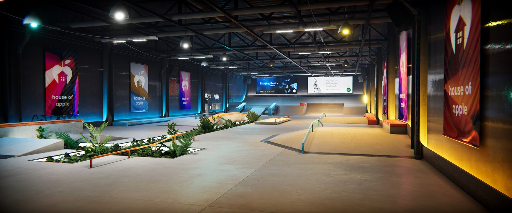

# Under the Big Apple for skate. (ReSkate)

**Under the Big Apple**, the Skater XL subway map created by ROARTEX89, ported to skate. by AltDoug
through [ReSkate](https://github.com/Dingo-Shenanigans/ReSkate).

Download it from Thunderstore (community `reskate`). This repository only holds the pictures for the release page.

## Credits
- Created by ROARTEX89 for Skater XL ([mod.io](https://mod.io/g/skaterxl/m/under-the-big-apple)). The pictures are
  the author's own screenshots from that page's download. ROARTEX89: if you want the port or these pictures changed
  or taken down, open an issue here and we will do it.
- Ported to skate. by AltDoug.
- ReSkate and ReSkate Studio by Dingo-Shenanigans and the ReSkate team.
- Spotbuilder by zeex64, used to convert the map.
- Port built with Claude Code (Anthropic), directed and tested by a human.
